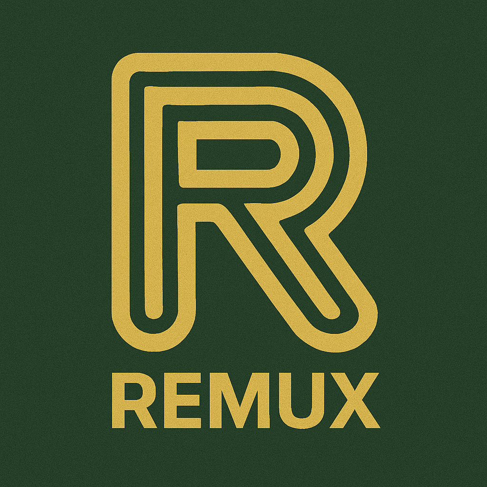
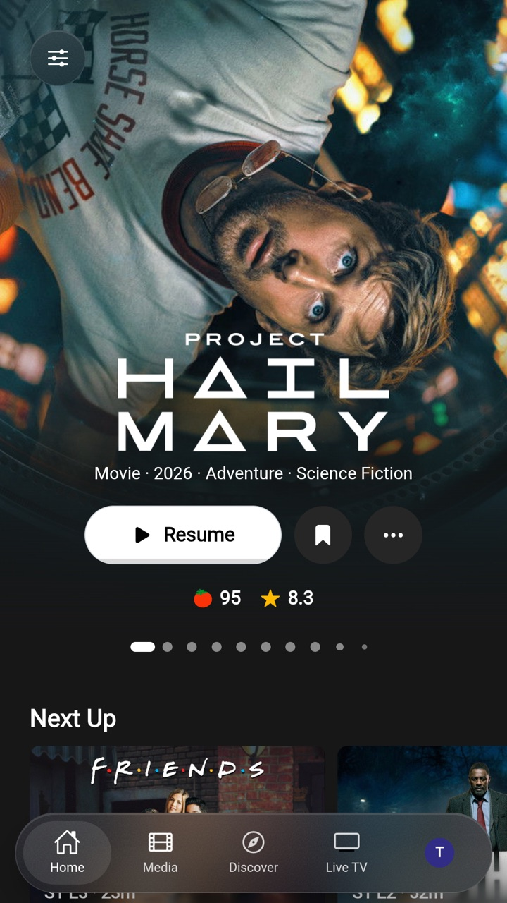
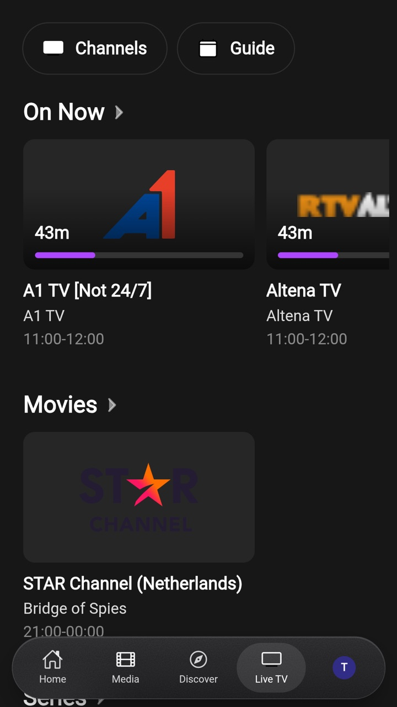
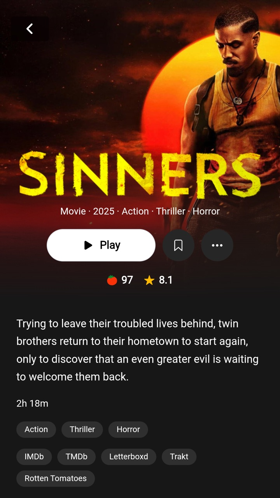
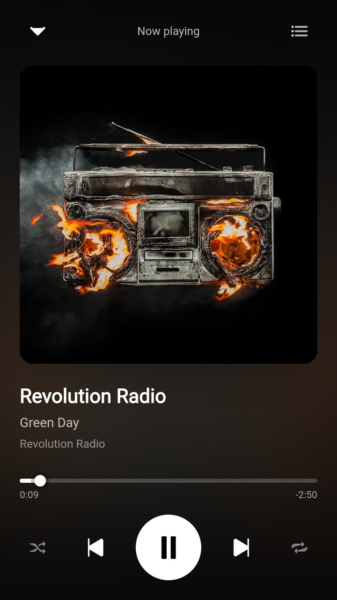
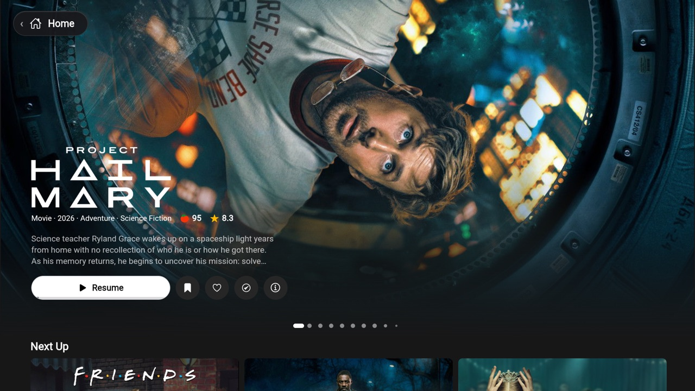
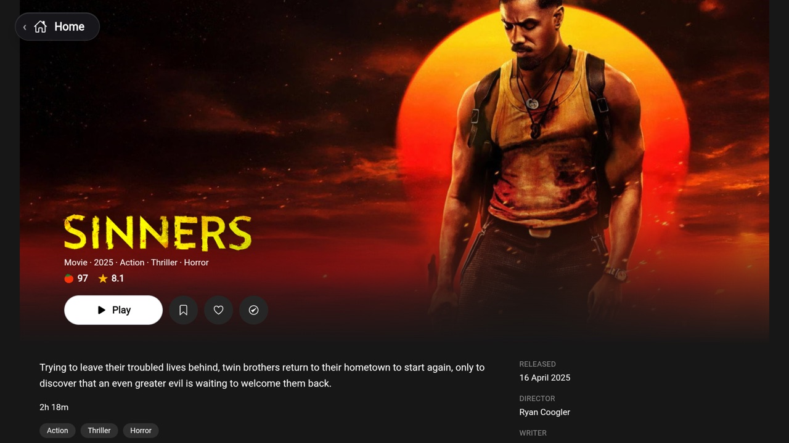

<div align="center">
   
</div>

<div align="center">
  <h1><b>Remux</b></h1>
  <p><i>A multi-platform client for Remux and Jellyfin servers, written in Rust</i></p>
<a href="https://discord.gg/rEbhk4RBhs">
    
</a>
</div>

---

Remux is a client for [Remux](https://github.com/lostb1t/remux) and Jellyfin servers that feels like
a streaming service: a big hero on the home screen, rows of posters, a detail page for every title,
and a player that handles whatever the server throws at it. One codebase (Rust and
[Dioxus](https://dioxuslabs.com)) for the web, iOS, Android phones, Android TV and the desktop.

It is a test build of an app that is being made: expect rough edges.

---

## Screenshots

<p align="center">
  
  
  
  
</p>

<p align="center">
  
  
</p>

## Features

- **Made for the sofa**
  Home with a hero that you swipe or step through, *Next Up*, and one row per library. The whole
  app works with a touch screen, a mouse, a keyboard and a TV remote.

- **Films, shows and collections**
  Libraries, collections (box sets, also collections of collections), favorites, and a watchlist on
  a Remux server. Every title has a detail page with its ratings, its genres and the versions of it that
  the server has.

- **A player that plays everything**
  mpv on iOS and the desktop, ExoPlayer on Android, the browser's own on the web. Pick the version,
  the audio and the subtitles; *Skip intro* and *Next episode* when the server knows where they are;
  HDR and Dolby Vision on a screen that shows them.

- **Live TV**
  A landing page with what is on now, the channels, and a guide.

- **Music**
  Albums, artists and playlists, with a player of its own.

- **Automatic quality** *(Remux server)*
  Measures the connection to the server (at the start, when the app comes back to the front, and
  when the network changes) and asks the server for versions that fit it. It is off by default.

- **More than one account**
  Sign in to several accounts and servers and switch between them without a password.

- **Android TV**
  Runs on a TV with the remote: every control can be reached with the D-pad, and a title opens
  with a zoom from its poster.

- **Works with Remux and Jellyfin**
  Built for [Remux](https://github.com/lostb1t/remux), and tested against Jellyfin.

## Get it

Every build is a pre-release under [Releases](../../releases); the newest is on top. The files say
the platform and the commit they were made from: `remux-android-<commit>.apk`,
`remux-macos-<commit>.dmg`, `remux-windows-<commit>.exe`, `remux-linux-<commit>.AppImage` (and
`.deb`).

| Platform | Where to get it |
| --- | --- |
| Android (phone and TV) | [Releases](../../releases), kept up to date with Obtainium (below) |
| macOS, Windows, Linux | [Releases](../../releases) |
| Web | Hosted at <https://app.remux.media>, as a Docker image, or as a zip (below) |

The hosted version only works for servers that are behind a reverse proxy and have HTTPS set up
correctly. If your server runs over HTTP, host the app yourself.

## Android, and keeping it up to date

Use [Obtainium](https://github.com/ImranR98/Obtainium), which installs the app and updates it as
new builds come out:

1. Install Obtainium.
2. Add an app, with this address: `https://github.com/lostb1t/remux-client`
3. Turn on **Include prereleases** (every build is one), and add the filter `remux-android-.*\.apk`
   for the APK if it asks for one.

All builds are signed with the same key, so they install over each other.

These are test builds of an app that is being made: expect rough edges.

## Web, as a Docker image

The web app is also a container image, for `linux/amd64` and `linux/arm64`. It is public: no login
is needed to pull it.

- Image: `ghcr.io/lostb1t/remux-client`
- Package page: <https://github.com/users/lostb1t/packages/container/package/remux-client>
- Tags: `nightly` is the newest build; `sha-<commit>` is one build, for pinning a version (the
  commit is in the name of the files on [Releases](../../releases) too).

```sh
docker run -d --name remux-client -p 8080:80 ghcr.io/lostb1t/remux-client:nightly
```

or with Compose:

```yaml
services:
  remux-client:
    image: ghcr.io/lostb1t/remux-client:nightly
    ports:
      - "8080:80"
    restart: unless-stopped
```

The app is then at <http://localhost:8080>; it asks for the address of your server when you sign in.
The image only serves the app (a small static web server): an address such as `/media/Movie/…` is
handled by the app itself, so any address should give the page.

To update, pull the tag again and restart the container
(`docker pull ghcr.io/lostb1t/remux-client:nightly`).

## Web, without Docker

Every build also has `remux-web-<commit>.zip` on [Releases](../../releases): the same files, to unpack
in the folder of a web server. The server has to answer any address that is no file with
`index.html`, as the app has its own router, and the app has to be served from the root of its
address (not from a folder such as `/app/`).

